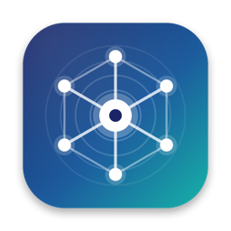
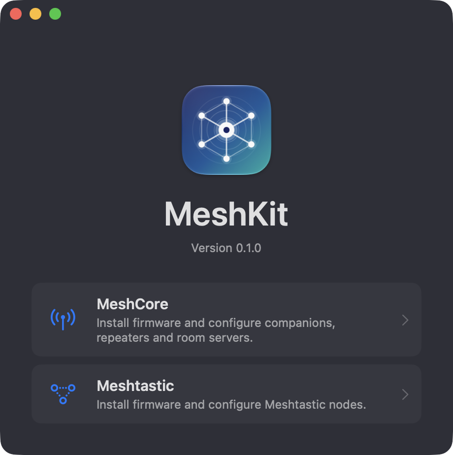
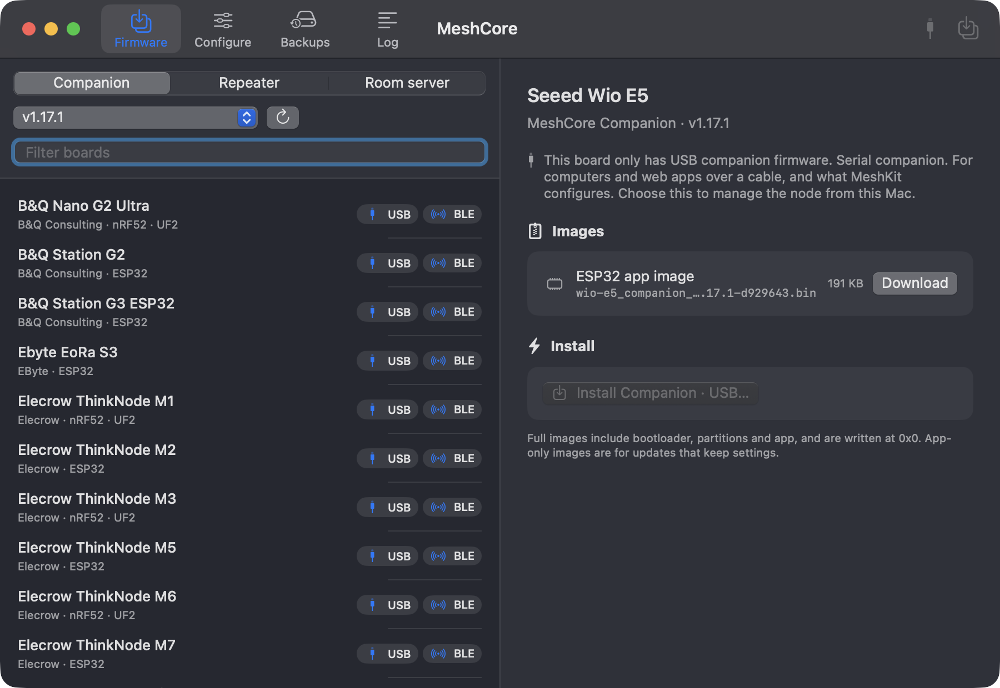

<p align="center">
  
</p>

<h1 align="center">MeshKit</h1>

<p align="center">
  Install, back up and configure <b>MeshCore</b> and <b>Meshtastic</b> radios from your Mac, over USB.
</p>

<p align="center">
  
  
</p>

> Unofficial, and largely AI-written (see [AI-DISCLOSURE.md](AI-DISCLOSURE.md)). Not affiliated with the MeshCore or
> Meshtastic projects.

---

MeshKit has a window for each project, **MeshCore** and **Meshtastic**, opened from the Welcome window or the Window
menu. The ESP32 flasher is written in Swift, so there's no `esptool`, Python or browser involved.

## Features

| | MeshCore | Meshtastic |
|---|---|---|
| **Firmware** | Companion, repeater and room server releases | Stable and Alpha releases |
| **Install** | ESP32 over serial, nRF52 via UF2 drive | ESP32 over serial (**Update** keeps settings, **Clean install** erases), nRF52 via UF2 |
| **Configure** | Companion (USB) and repeater / room server: name, location, radio, routing, adverts | Names, region, modem preset, hop limit, TX power, role |
| **Radio presets** | Community presets by region, plus your own | Meshtastic's modem presets |
| **Back up** | Settings snapshots and full ESP32 flash images | Same |

Any `.bin` or `.uf2` can be flashed from File ▸ Flash Image from File (⌘O) or by dropping it on the window. Demo devices
let you try everything without hardware.

## Install

Download the zip or DMG from Releases and drag **MeshKit.app** into Applications. It isn't notarised, so on first launch
Control-click it and choose **Open**.

To build from source (Swift 6 toolchain, macOS 14+):

```sh
./Scripts/build-app.sh      # build/MeshKit.app
./Scripts/package.sh        # universal build, plus a zip and DMG in build/release
swift test
```

## Hardware

| Chip | Install | Status |
|---|---|---|
| ESP32, S2, **S3**, C2, C3, C6, H2 | Serial | Tested on a **Heltec V3**: Meshtastic (including clean install) and MeshCore companion and repeater, flashed and configured |
| nRF52840 (e.g. Wio Tracker L1) | UF2 drive | Unit-tested; not tried on a real board |
| ESP32-P4, RP2040 / RP2350, STM32 | | Not supported |

## Safety

- ESP32 installs first save the whole flash to `~/Library/Application Support/MeshKit/FlashBackups` (this can be turned
  off in Settings). **Backups ▸ Restore** writes one back. These files contain keys and Wi-Fi settings, so keep them private.
- Images for the wrong chip, or larger than the flash, are refused before anything is erased.
- MeshKit only reads from the network: GitHub (firmware), `api.meshtastic.org` and `api.meshcore.nz`.
- Radio frequency and power limits depend on where you are. Choosing a region or preset is your responsibility.

## Troubleshooting

- **No board listed:** use a data cable, close anything else using the port, and replug.
- **Can't enter the bootloader:** hold **BOOT**, tap **RESET**, release BOOT, and try again. If a write fails partway, lower
  the speed to 115,200 in the install sheet.
- **UF2 drive missing (nRF52):** double-tap **reset** quickly.
- **"Nothing answered…":** the board needs MeshCore USB companion, repeater or room server firmware, or Meshtastic
  firmware, matching the window you connected from.
- The **Log** tab shows every command and reply; include it in bug reports.

## License

GPL-3.0 ([LICENSE.md](LICENSE.md)), because it links Meshtastic's GPL-3.0 protobuf definitions. Other components are
listed in [THIRD-PARTY-NOTICES.md](THIRD-PARTY-NOTICES.md). Names and trademarks belong to their owners.
